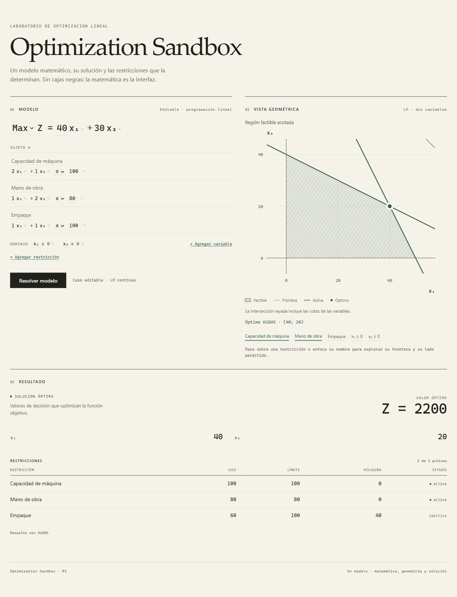

# Geometría 2D — M3

La vista geométrica consume el mismo `OptimizationModel` que el editor y `/solve`. Sus datos son
derivados y desechables: nunca se editan, guardan ni envían al backend. El contrato HTTP de M1
permanece intacto. La geometría no evalúa la función objetivo para buscar una solución.

## Responsabilidades

- **M3A — `web/lib/geometry.ts`:** funciones TypeScript puras; fronteras, semiplanos, factibilidad
  geométrica, acotación de la región y recorte al viewport.
- **M3B — `web/components/geometric-view.tsx`:** renderer SVG, etiquetas, leyenda, estados y
  exploración por hover/foco. Solo transforma coordenadas matemáticas a píxeles.
- **M3C — `Sandbox` y CSS:** composición Modelo | Vista geométrica, resultados debajo; una columna
  hasta 980 px. `Sandbox` conserva el estado canónico y comparte el ID resaltado.

Se eligió **SVG nativo**: permite fronteras identificables, áreas recortadas, patrones, eventos y
accesibilidad en React sin una dependencia de plotting. Canvas exigiría hit testing y accesibilidad
adicionales. El tamaño de los LP educativos de esta etapa no justifica esa complejidad.

## Representación derivada

`computeGeometry(model, optimalPoint?)` devuelve:

- estado `bounded`, `unbounded` o `infeasible`;
- IDs de las dos variables (primera = eje horizontal, segunda = eje vertical);
- viewport, vértices factibles finitos e intersección visible (`region`);
- fronteras normalizadas `a*x + b*y = c`, operador original, segmento visible y lado permitido;
- `constraintId` para restricciones; `variableId` y lado para las cotas.

Los estados `unsupported` y `numerical-error` sustituyen la geometría cuando no hay exactamente dos
variables o la escala no es representable con seguridad. El editor y la resolución siguen disponibles.
La intersección visible puede ser un polígono, un segmento, un punto o estar vacía.

Las cotas inferiores/superiores se convierten en semiplanos solo dentro de esta derivación. No se
agregan restricciones al modelo canónico. Los términos ausentes tienen coeficiente cero. Una
igualdad aporta dos desigualdades opuestas para la intersección, pero conserva una única frontera
visual y **ningún semiplano sombreado individual**. Las ecuaciones con ambos coeficientes cero se
tratan como tautologías o contradicciones, sin intentar dibujar una recta inexistente.

## Factibilidad y acotación antes del recorte

Las desigualdades se orientan como `a*x + b*y <= c`, con normal unitaria. Para cada frontera se
parametriza `p(t) = c*(a,b) + t*(-b,a)` y se intersecta su intervalo permitido por todas las demás
desigualdades. Esto funciona con rectas verticales, horizontales, paralelas y coeficientes negativos.
Los extremos finitos son vértices candidatos; un punto del intervalo es un testigo factible.

Si el origen satisface todas las desigualdades, es también un testigo. Si no existe ni ese testigo
ni un intervalo factible sobre ninguna frontera, la región es vacía. No se decide infactibilidad
por ausencia de píxeles dentro de una ventana arbitraria. El método incluye bandas, semiplanos y
rectas infinitas que no tienen vértices.

Una región factible es no acotada si existe una dirección no nula `d` con `a*d.x + b*d.y <= 0` para
todas las normales. En 2D basta comprobar los ejes y las dos tangentes de cada frontera: todo cono
de recesión no trivial contiene una de esas direcciones. Las igualdades aportan ambas normales.
Esta clasificación describe **la región**, no el objetivo. Una región infinita puede tener una
solución óptima finita; solo HiGHS determina el estado de la resolución.

La región visible se obtiene recortando un rectángulo mediante intersecciones sucesivas de
semiplanos convexos. Las fronteras del rectángulo son límites de visualización, nunca restricciones.
No se dibuja un contorno cerrado artificial en los extremos de regiones infinitas. Los segmentos
y puntos factibles se dibujan explícitamente para no perder las regiones sin área.

## Viewport

Se usan primero los vértices factibles y, en regiones sin vértices, los testigos de sus fronteras.
Así las intersecciones lejanas entre restricciones redundantes no agrandan la ventana. Si no hay
una región factible, se toman hasta cuatro proyecciones de frontera cercanas al origen; sin datos
naturales se usa una extensión de 10 unidades. El óptimo vigente, cuando existe, se incluye siempre.

Se añade margen, se incluye el origen cuando queda razonablemente cerca y se conserva la misma
escala en ambos ejes (área de trazado 5:4). La región lejana no se comprime para incluir el origen.
No hay zoom/pan en M3; una frontera fuera de ventana se conserva en la leyenda y su semiplano puede
explorarse. Un modelo verdaderamente muy alargado puede exigir un rango amplio para mostrar toda
su región; no se ocultan vértices factibles para mejorar la composición.

## Precisión y límites

Las normales se normalizan escalando primero por el mayor coeficiente para evitar overflow en el
cálculo de la longitud. La tolerancia del test de pertenencia es:

```text
1e-9 + 64 * Number.EPSILON * (|a*x| + |b*y| + |c|)
```

El primer término es una distancia en unidades de variable tras normalizar; el segundo cubre ruido
de redondeo a escalas grandes. Paralelismo y direcciones de recesión usan `32 * Number.EPSILON`
sobre normales unitarias. Las restricciones constantes se comprueban directamente, pues no hay
operaciones de coordenadas que justifiquen convertir una contradicción pequeña en una tautología.

Esta política sirve para dibujo y clasificación geométrica aproximada. **No sustituye la tolerancia
de HiGHS** ni calcula `active` o `slack`. Las restricciones activas se toman exclusivamente del
resultado vigente. Cerca de degeneraciones a escala inferior a la tolerancia, las clasificaciones
geométricas pueden diferir de las del solver. Las fronteras casi paralelas dentro de la tolerancia
angular se consideran paralelas. No se promete aritmética exacta.

Offsets normalizados no finitos o mayores que `1e140` muestran una limitación numérica explícita,
sin inventar infactibilidad. La evaluación de intervalos y direcciones es cuadrática en el número
de fronteras; el recorte elimina duplicados para mantener una representación convexa pequeña.
No se añade un motor geométrico de N dimensiones.

## Solución, obsolescencia e interacción

`resultPoint` solo lee `variableValues` por ID de un `OptimizationResult` óptimo. `Sandbox` pasa el
resultado a la vista únicamente si corresponde a la referencia actual del modelo. La vista añade
un segundo guarda de obsolescencia: un resultado antiguo no aporta punto, restricciones activas ni
viewport. El panel de resultados conserva su comportamiento de M2.

Los IDs enlazan el hover/foco del editor con la frontera y viceversa. La leyenda permite explorar
restricciones y bounds con teclado o toque. Al explorar una desigualdad se sombrea su lado permitido;
el rayado representa siempre la intersección completa. La igualdad solo resalta su frontera.

## Validación

La suite incluye tests puros de intersecciones, verticales/horizontales, signos, Product Mix,
infactibilidad, regiones infinitas, bounds, redundancia, IDs, igualdades, puntos, bandas, escalas y
viewport. Los tests React cubren edición inmediata, resultados vigentes/obsoletos, respuestas
tardías, cambios estructurales, dimensiones no soportadas, exploración e hidratación SSR del SVG.

Verificación manual de M3 con navegador Chromium y FastAPI + HiGHS reales:

1. Product Mix: región inicial; resolver → `(40, 20)`, `Z = 2200`.
2. Capacidad `100 → 120`: región inmediata, óptimo anterior oculto; resolver →
   `(53,3333; 13,3333)`, `Z = 2533,3333`.
3. Agregar `x₁ <= 20`: frontera vertical; resolver → `(20, 30)`, `Z = 1700`.
4. Cambiar esa restricción a `-x₁ + x₂ <= -10`: región y solución válidas.
5. Cambiar RHS a `-1000`: región vacía inmediata y resultado `infeasible` de HiGHS.
6. Eliminar las restricciones explícitas: cuadrante infinito y resultado `unbounded` de HiGHS.
7. Layout de escritorio y móvil de 390 px; sin desbordamiento horizontal móvil.

La automatización del navegador no forma parte de la suite versionada.


